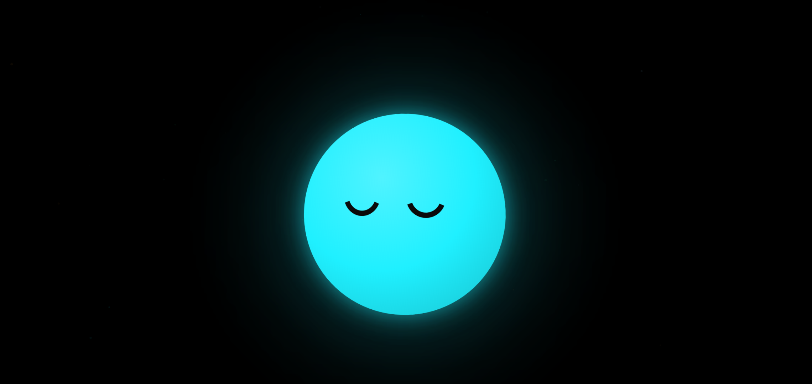
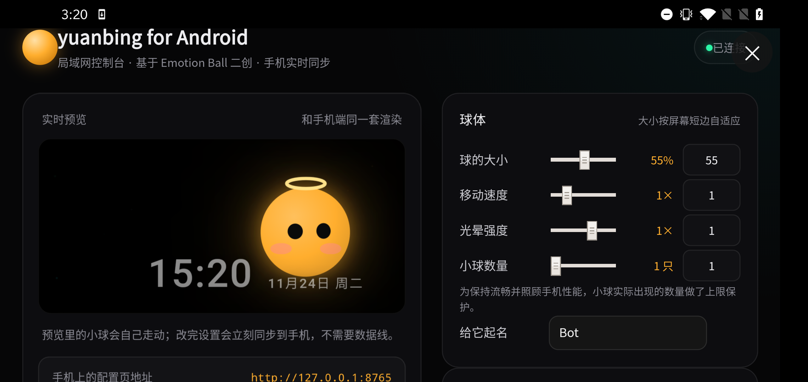
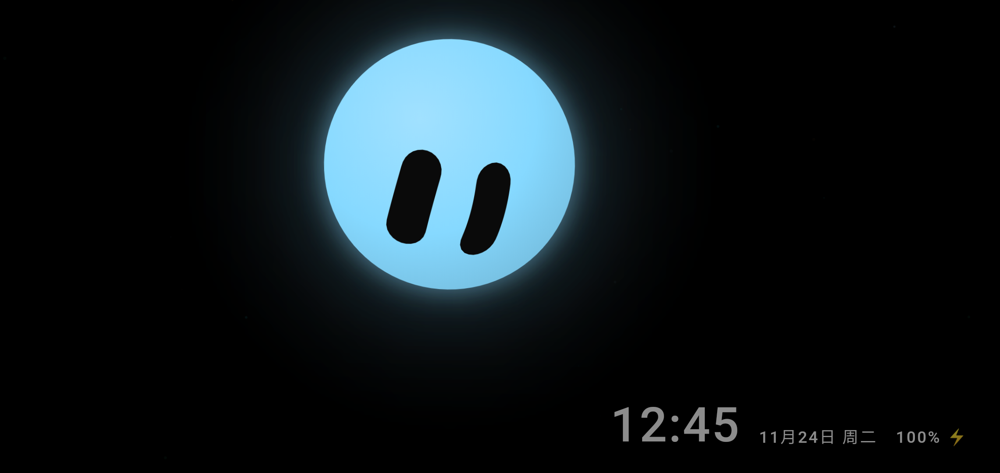
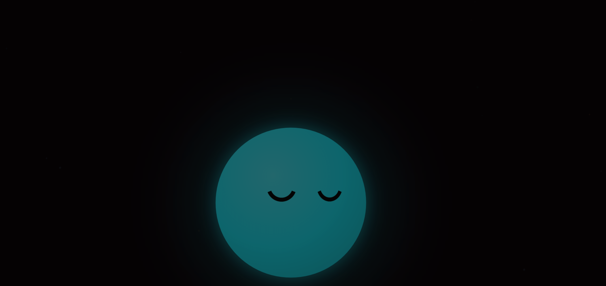

# yuanbing for Android · 桌面表情球

> **yuanbing for Android** 是基于 [aora-bot / Emotion Ball](https://github.com/sam70361/aora-bot/tree/emotion-ball) 的非官方二创，不是 Emotion Ball 官方项目。名字、控制台和交互壳都是本项目自己的；表情引擎与球形视觉来自上游，并遵守其非商业许可。

把 [aora-bot 的经典 emotion-ball 分支](https://github.com/sam70361/aora-bot/tree/emotion-ball) 做成一个**完全离线**的 Android 桌面陈列 App：

> 一颗会自己走、会换脸、能被戳、被拖、被甩出去撞墙的表情球。横屏、纯黑背景，放在桌面支架里就是一只安静的小桌宠。

- 包名：`com.emotionball.desk`
- 版本：**4.7**（versionCode 11）
- 安装包：[`dist/yuanbing-for-Android-v4.7.apk`](dist/yuanbing-for-Android-v4.7.apk)（约 138 KB）
- 已实测：OnePlus 6T（Android 9 / SDK 28），1080×2280 横屏全屏
- **不依赖电脑、不联网也能运行**；只有改设置时才需要手机和电脑在同一个 Wi-Fi



## 截图

| 局域网控制台 | 手机控制台 |
| --- | --- |
|  |  |

| 小挂件（默认关闭） | 夜间模式 |
| --- | --- |
|  |  |

## 现在能做什么

### 一颗有性格的球

- 平时自己慢慢走、停下来发呆、朝随机方向看、呼吸、眨眼。
- 每 **25–45 秒**换一次眼型和颜色；颜色只在淡出→淡入的瞬间切换，**停留期间不会慢慢渐变**。
- **21 种眼型**：12 种新画的（爱心、星星、闪光、漩涡、× ×、弯弯眼、困困眼、圆豆眼、小豆眼、樱花、雪花、南瓜）+ 9 种原版里比较可爱的。
- 默认四种颜色：琥珀金 `#FFAE2E`、冰蓝 `#86D9FF`、电光青 `#1FF0FF`、翡翠绿 `#2BF5A6`；控制台最多可加到 8 种。

### 互动

| 手势 | 效果 |
| --- | --- |
| 轻点球 | 眨一只眼 + 指尖涟漪 + 轻震动 + “唔”一声 |
| 连续快速点 3 下 | 被挠痒，咯咯笑 + 抖一抖 + 冒星星 |
| 双击球 | 立刻换一种颜色 + 爱心眼 0.9 秒 + 小星星炸开 + “啵” |
| 长按 0.2 秒 | 把球拿起来，拖动时跟着手指走 |
| 拖动后松手 | 按松手速度甩出去；撞到屏幕边缘会挤压回弹 + 墙边涟漪 + “duang~” + 震动 |
| 双指捏合 | 缩放球的大小 |
| 双指旋转 | 转动球面（像转地球仪） |
| 拿起/翻转/摇手机 | 传感器反应：吓一跳、犯困、晕乎乎（需要设备有加速度计） |

### 作息、电量与陪伴

- **夜间模式**（默认 23:00–07:00）：自动调暗 + 困眼；摸一下会醒 30 秒，然后继续睡。
- **电量情绪**：充电时开心；满电打瞌睡；低电量没精神。
- **久坐提醒**：3 分钟没人理就打瞌睡，而不是永远精神抖擞。
- **名字与气泡**（默认关闭）：可以在控制台给它起名；打开后每 10–30 分钟偶尔冒一句“在呢”“唔…”“再戳就生气了”。低频才可爱。

### 换装与分享

- **主题包**：琥珀夜、冰蓝实验室、森林精灵、樱花季、赛博、奶油糖，一键套用。
- **配饰**：12 种——腮红、呆毛、睡帽、小围巾、贝雷帽、小花、耳机、圆眼镜、小皇冠、猫耳、光环、蝴蝶结；全部是矢量绘制，叠在球上不用重画。
- **自定义配饰**：控制台可以上传自己的 PNG/JPEG/WebP 图片（透明底最好），并调位置、大小、旋转；传新图会自动替换旧图。
- **分享码**：把颜色、眼型、背景、大小打包成一段短码，朋友导入就是同款。
- **明信片**：一键把当前画面存成 PNG（保存在手机 App 私有目录，控制台会给出链接）。

### 多球模式

- 控制台滑块可选 **1–10 只**；数字输入框最多可填 **20**。
- 每只小球大小不同，会绕主球换脸、移动；**实际出现数量有性能上限**，避免老手机掉帧。
- 把“移动速度”拉到 **0×**，所有球都会停住不动（呼吸/眨眼仍在）。
- 配饰、颜色、眼型对主球生效；小球继承主题配色。

### 控制台的数字输入 / 音效上传

- 每个滑块右边都有数字输入框：**输入数字就按数字生效，清空后回到滑块值**。
- 不同项上限不同：球大小最高 80%（填 2200 也只到 80%）、速度最高 99×、小球数量最高 20、打瞌睡等待最高 1440 分钟（等于一天不打瞌睡）。
- “音效”分区可分别替换：戳一戳、双击/啵、撞到边缘、被挠痒、打哈欠、晕乎乎。支持 mp3 / wav / ogg / m4a，单个 ≤4 MB；不上传时使用内置合成音。

## 手机控制台（v4.7）

- **本机**：左上角 120dp 内 3 秒连点 6 下 → 弹出菜单 → “打开控制台（本机）”，直接在手机里打开控制台；按返回或右上角 ✕ 回到球。
- 菜单里的地址旁有 **“复制网址”** 按钮，点一下就把带 token 的完整地址放进手机剪贴板，发到电脑或另一台手机即可打开。
- **同一 Wi-Fi 的其他手机/电脑**：浏览器打开手机菜单里显示的完整地址（`http://<手机IP>:8765/t/<随机token>/`）。根地址 `http://<手机IP>:8765/` 会返回 403，必须带 token。
- 控制台已适配竖屏手机（单列）和横屏（双列）；上传图片走系统文件选择器，手机本机也能直接选图。

## 快速开始

1. 安装 APK：

   ```bash
   adb install -r dist/yuanbing-for-Android-v4.7.apk
   ```

2. 设为默认桌面（这样按 Home / 重启后会回到球）：

   ```bash
   adb shell cmd package set-home-activity com.emotionball.desk/.MainActivity
   ```

3. 打开 App：横屏、沉浸式全屏、常亮、屏幕亮度 45%、刘海区铺满。

4. 左上角 120dp 范围内 3 秒内连点 6 下：弹出菜单，可“打开控制台（本机）”或“退出到桌面”；再按 Home 回到表情球。

## 局域网控制台

手机连上 Wi-Fi、App 正在运行时，在**同一个 Wi-Fi 下的电脑/手机浏览器**打开手机菜单里显示的完整地址：

```
http://<手机的局域网 IP>:8765/t/<随机 token>/
```

token 每次启动随机生成；根地址 `/` 和 `/api/*` 不带 token 一律 403，避免同一 Wi-Fi 下被人随手打开。8765 被占用会自动顺延到 8766–8795。

控制台能改：

- 球的大小（28%–80%）、移动速度（0–5×，数字可到 99×）、光晕强度、换脸间隔；
- 球的数量（滑块 1–10，数字最多 20；实际渲染数量有性能上限）、宠物名字；
- 每个滑块右边的数字输入（输入优先，清空回落到滑块；各项有独立硬上限）；
- 增删颜色（最多 8 种）；
- 参与轮换的眼型（至少一种；**全不选时不会同步到手机**，方便逐个预览）；
- 自定义眼睛图片（PNG，透明底最好，最大 512×512），调大小、间距、左右镜像；
- 背景纯色或图片（最大 1920×1080），调暗度、模糊；
- 配饰、气泡频率；
- 音效分区：戳一戳/双击/撞墙/被挠痒/打哈欠/晕乎乎，逐项上传自定义音频；
- 夜间模式、电量情绪、久坐打瞌睡、体感反应、防烧屏五个独立开关；
- 小挂件（时间/日期/电量，默认关闭）；
- 主题、分享码、明信片；
- **一键导出/导入配置**：导出的 JSON 包含已上传的眼睛、背景、配饰、音效（base64），换手机可直接导入；
- **防烧屏**（默认开启）：每 1–3 分钟把画面整体随机偏移几像素，避免 OLED 长期显示同一位置；
- 上传处标注了建议分辨率：眼睛/配饰 512×512、背景 1920×1080。

所有改动 **320 ms 防抖后自动保存**，手机上的球会立刻应用；左边是同一套渲染的实时预览。底部有：

- **撤销本次修改**：撤销上一笔（连续拖动滑块会合并成一步）；
- **恢复默认**：颜色、大小、背景、配饰、开关全部回到初始值。

如果同时开了多个控制台页面，后保存的页面会带上时间戳；旧页面再保存时会提示“另一个页面刚改过，请刷新后再改”，不会静默覆盖。

上传的图片只保存在 App 私有目录，通过 `/media/...` 提供；清空图片或恢复默认时会删掉旧文件。控制台用每次启动随机生成的 token 保护，**只适合可信的家庭/办公室局域网**；不要把 8765 映射到公网。

## 不同分辨率 / 屏幕边缘自适应

- 球的大小：`size = min(屏幕宽, 屏幕高) × ballScale`，再限制在 `宽×0.66`、`高×0.92` 以内，最小 110 px；换到 16:9、19.5:9、4:3 或平板比例都不会大到出界。
- 活动范围读取刘海/挖孔安全区（`Native.cutout()`），再加 8 px 边距；球心被夹在安全区内，不会钻进 6T 的刘海。
- 自定义眼睛、光晕、阴影、配饰都按 `size` 的比例缩放；旋转、分屏、改分辨率会重新布局。
- 球被甩到边缘时按速度反弹，不会卡在屏幕外。

## 构建

构建脚本面向 **Windows + Git Bash**（Linux/macOS 可把 `aapt2.exe` / `zipalign.exe` 改成无后缀，并调整工具路径）。

需要：

- JDK 17
- Android build-tools 33（`aapt2`、`zipalign`、`d8.jar`、`apksigner.jar`）
- Android platform 33 的 `android.jar`
- Python 3（只用于修正 Windows 反斜杠资源名）

不需要 Gradle。设置环境变量（或直接改 `build.sh` 顶部的默认值）：

```bash
export EB_JDK=/path/to/jdk-17
export EB_BT=/path/to/build-tools/33.0.2
export EB_PLATFORM=/path/to/platforms/android-33
export EB_STOREPASS='你的签名密码'
# 可选：export EB_KEYPASS='与上面不同时再填'
# 可选：export EB_PYTHON=/path/to/python

cd <项目目录>
bash build.sh
```

脚本依次做 aapt2 link → javac（编译 `android/src` 下所有 Java）→ d8 → `android/pack.py` 修正资源名 → zipalign → apksigner，输出 `build/yuanbing-for-Android.apk`。

签名文件默认在 `signing/emotionball.jks`（alias `emotionball`，密码从 `EB_STOREPASS` / `EB_KEYPASS` 读取），**不要删**，否则覆盖安装会签名冲突；发布时请换成你自己的 keystore，且不要把它提交到仓库。

## 还原 / 卸载

```bash
# 把 <桌面组件> 换成你手机原来的桌面（例如 com.android.launcher3/.Launcher）
adb shell cmd package set-home-activity <桌面组件>
adb uninstall com.emotionball.desk
```

或在「设置 → 应用 → 默认应用 → 桌面」里改回系统桌面，再卸载。没有 root、没有改系统分区、没有改开机流程；所有效果都在普通 App 权限内。

## 已知限制

- 部分 ROM 重启后可能仍显示滑动锁屏，向上滑一次即可；App 会尽量自己盖过去，但不同 ROM 行为略有差异。
- 音效走 Web Audio，首次触摸后才会启用（浏览器自动播放限制）；体感功能依赖设备加速度计。
- 局域网控制台用随机 token 保护；把完整地址发给别人，对方就能打开。token 重启后会变。
- 声音、体感、双指缩放目前以代码/合成触摸测试为主，尚未在所有机型上逐一实测。

## 许可与致谢

本项目是非官方衍生作品，基于 [sam70361/aora-bot](https://github.com/sam70361/aora-bot) 的 `emotion-ball` 分支。

- 上游采用 **Emotion Ball Community License**：非商业免费；引擎/表情数据的商业授权可联系 `1251579308@qq.com`；**球形角色的视觉形象永久禁止商业使用**。
- 本仓库继续遵循同一非商业许可；必须保留 [`LICENSE`](LICENSE)、[`LICENSE-COMMERCIAL.md`](LICENSE-COMMERCIAL.md) 与 [`NOTICE.md`](NOTICE.md)。
- 新增的 Android 外壳、控制台、眼型、性格与多球代码同样按该非商业许可提供，不提供商业授权。
- 原项目版权：Copyright (c) 2026 sam70361。

## 目录结构

```
desk-app/
├─ www/                 # WebView 页面（desk.js / eyes.js / 控制台）
├─ android/             # 原生外壳、ConfigServer、资源打包脚本
├─ build.sh             # 无 Gradle 构建
├─ dist/                # 可安装 APK
├─ docs/                # 截图
├─ LICENSE / NOTICE.md  # 上游许可与声明
└─ README.md
```
